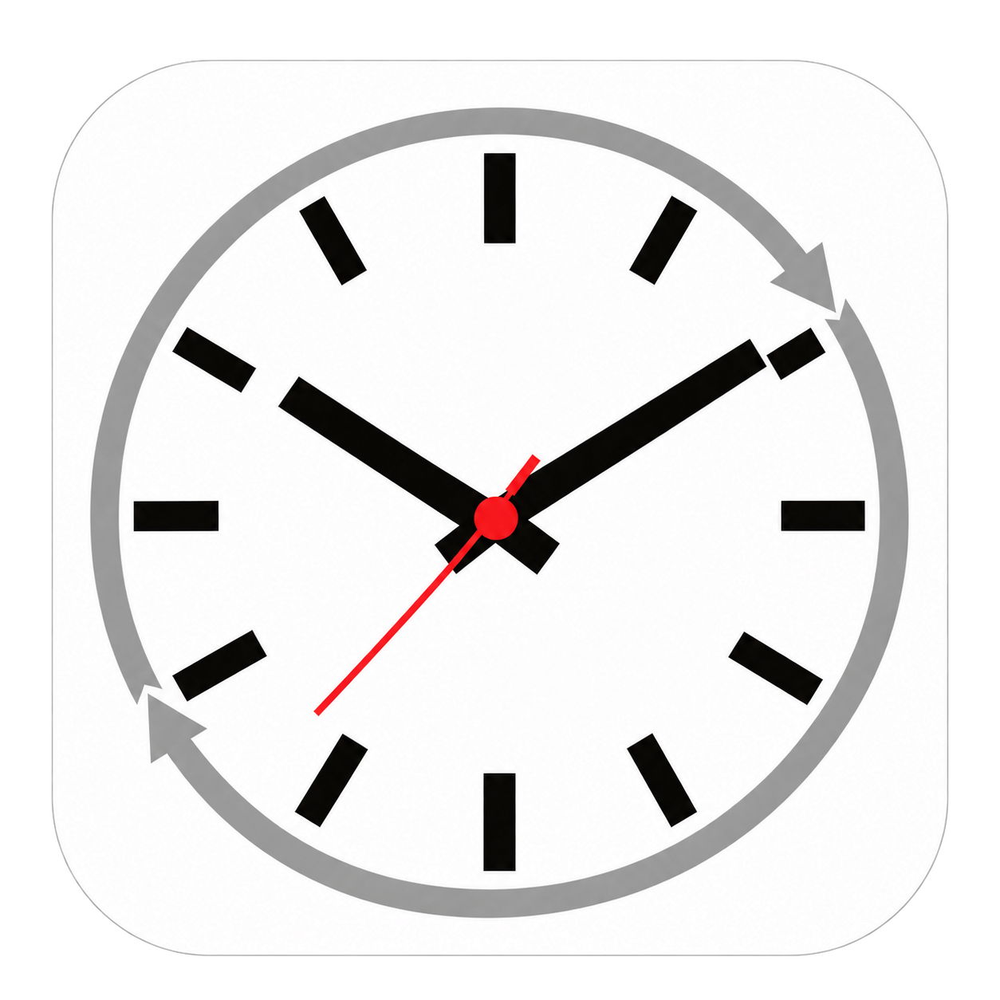

<p align="center"></p>

# TZswitch

A small macOS app for switching the **system timezone**. Choose any timezone available on your Mac, and keep one or two favorites. One city is enough to start.

[中文说明](README.zh-CN.md) · [User guide (中文)](docs/USER_GUIDE.zh-CN.md) · [Download](https://github.com/jockerxb/TZswitch/releases/latest) · [MIT License](LICENSE)

## Use

See the **[App user guide (中文)](docs/USER_GUIDE.zh-CN.md)** for installation, first-run setup, UTC search examples, navigation, authorization, and troubleshooting.

1. Download the universal ZIP from Releases, extract it, and drag **TZswitch.app** into Applications.
2. On first launch, choose a favorite city in either empty slot to get started. The second city is optional. Search the global catalog, grouped by current UTC offset from lowest to highest; the current group header stays pinned while scrolling. Use the right-hand UTC index to jump between groups. Counts distinguish current UTC-offset groups from deduplicated city entries. Offset searches accept `utc9`, `utc-8`, and `utc5:30`. Choosing a city immediately requests macOS administrator authorization to switch. The new favorite is saved only after verified success; cancellation or failure preserves the previous favorite and system timezone. Click Close or press Esc to return without choosing.
3. Approve the macOS administrator prompt triggered by choosing the city. The app verifies and applies it immediately; no second card click is needed.
4. For later changes, click the card body to apply a favorite or its right-hand `>` area to change the city. The green border marks the active timezone. Close the window to quit; the applied system timezone stays in effect.

Requires macOS 13 or newer; the universal app includes Apple Silicon and Intel binaries. The current interface is in Chinese. Search accepts localized Chinese city names, English city names, IANA IDs such as `America/Los_Angeles`, and offsets such as `UTC+05:45`. Beijing and 北京时间 resolve to Beijing / Shanghai (`Asia/Shanghai`). Compatibility IDs for the same city with identical full timezone rules appear once, while their old names remain searchable.

The release uses an **ad hoc signature**. It is not Developer ID signed or notarized, so macOS may require approval in **System Settings → Privacy & Security** on first launch. Only approve a download you trust. You can also build from source below.

### If macOS says Apple cannot verify TZswitch

After confirming that the package came from [this repository's Releases](https://github.com/jockerxb/TZswitch/releases/latest):

1. Click **Done** in the blocked-app dialog.
2. Open **System Settings → Privacy & Security**, then scroll down to the notice about TZswitch.
3. Click **Open Anyway**, authenticate as prompted, then click **Open**.

macOS remembers this exception for the app. See [Apple's official instructions](https://support.apple.com/102445).

## Behavior

- One or two customizable, distinct favorite timezones. New installs start with empty slots; choosing one city completes setup. A single favorite stays usable after reopening, and existing choices are preserved.
- The timezone catalog and daylight saving rules come from macOS [Foundation TimeZone](https://developer.apple.com/documentation/foundation/timezone). The list follows the system timezone database rather than a bundled city list.
- A manual switch disables automatic timezone selection to keep macOS from switching back based on location. Network time synchronization is left alone.
- Launching, dismissing the picker without choosing, and quitting do **not** change the system timezone. Choosing a city or clicking a card requests authorization to switch. Quitting keeps the last applied system setting; reopening reads the actual current setting.
- No menu bar status item and no background service. Closing the window quits the app. Complete or cancel an active authorization before quitting.
- No telemetry, account, or external runtime dependencies. Timezone operations make no network requests. The GitHub link at the top right opens the project in your default browser only when clicked, for source code, updates, or issue reporting.

## Build and test

Install Apple's Xcode Command Line Tools (`xcode-select --install`), then:

```sh
git clone https://github.com/jockerxb/TZswitch.git
cd TZswitch
./build.sh                 # universal app → dist/TZswitch.app
./test.sh                  # no system timezone modifications
./package.sh               # build + test + release ZIP and SHA256SUMS.txt
```

For a faster local build, use `./build.sh arm64` or `./build.sh x86_64`. Sources use Swift, SwiftUI, and AppKit. The icon tool uses Python 3's standard library and native CoreGraphics. An Intel build can be cross-compiled on Apple Silicon; running it requires a compatible Mac or Rosetta.

Tests cover DST boundaries, fractional offsets, global search and UTC grouping, first-run setup, legacy preference migration, saved preferences, invalid input, verified switching results, rollback transactions, and all 11 ICNS representations. Selection-flow tests cover cancellation, execution and verification failures, success, first-run setup, and reload persistence. Transaction and selection-flow tests use fake OS commands and never request administrator privileges. AppleScript syntax checks are skipped if the environment cannot load Standard Additions; the app also compiles its authorization script before use. Real privileged switching and visual checks require a Mac and manual authorization.

## Implementation

`Sources/TimezoneCore.swift` owns the validated timezone catalog, preferences, system snapshot, and switching transaction. `Sources/AppModel.swift` owns authorization flow and preference commits after success; `Sources/main.swift` contains the UI and app lifecycle. Only explicit switch actions run the administrator script. IDs must be in the system allowlist and are shell-quoted at the command boundary. Failed transactions attempt to restore the previous timezone and automatic-selection setting.

GitHub Actions builds, tests, and packages pushes and pull requests. A `v*` tag publishes a release after those checks pass; the tag must match the version in `Info.plist`.

## Contribute

Open an issue with your macOS version and a reproducible example, or submit a pull request. Run `./package.sh` before proposing a release. Please avoid adding passwords, personal preferences, signing credentials, or local build outputs to the repository.

If TZswitch helps you, a [Star](https://github.com/jockerxb/TZswitch) is welcome—it bookmarks the project and supports its continued improvement.
