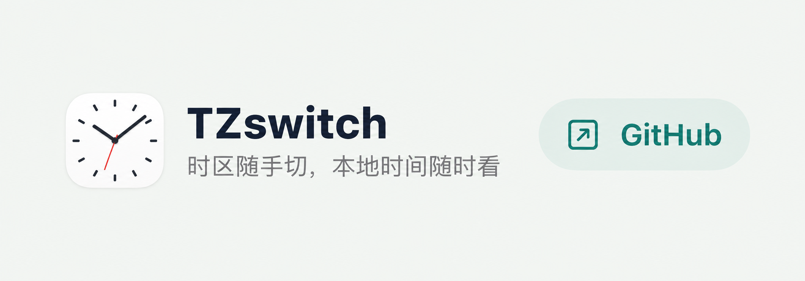
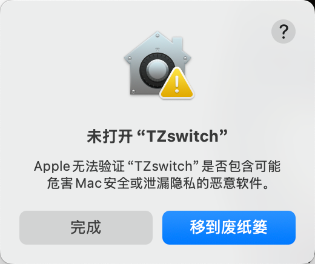

<p align="center"></p>

# TZswitch

[English](#english) · [中文说明](#chinese) · [Download / 下载](https://github.com/jockerxb/TZswitch/releases/latest) · [MIT License](LICENSE)

<a id="english"></a>

## English

**Switch your system time zone. Keep local time in sight.**


### When to use TZswitch

Switch the system time zone for a VPN-related workflow or a trip, while keeping home or local time easy to see.

For example: use Los Angeles time for macOS and Beijing time in the menu bar.

### Features

- **Favorite time zones:** Save up to 3 cities. Click a saved city to change your Mac’s time zone. Adding a city doesn’t switch it.
- **Chinese and English:** Use the language icon next to GitHub; your choice is remembered.
- **Backup time zone:** See another city’s day and time in the menu bar, even after closing the window. Hide it at any time without changing your Mac’s time zone.

[Download the latest release](https://github.com/jockerxb/TZswitch/releases/latest) · [Installation and user guide (中文)](docs/USER_GUIDE.zh-CN.md)

### System requirements

- **macOS 13 or newer**, on Apple Silicon or Intel.
- No additional software required. Switching the system time zone needs administrator authorization; the backup time zone display needs no extra permissions.

<details>
<summary>Build from source and test</summary>

### Build and test

Install Apple's Xcode Command Line Tools (`xcode-select --install`), then:

```sh
git clone https://github.com/jockerxb/TZswitch.git
cd TZswitch
./build.sh                 # universal app → dist/TZswitch.app
./test.sh                  # no system time zone modifications
./package.sh               # build + test + release ZIP and SHA256SUMS.txt
```

For a faster local build, use `./build.sh arm64` or `./build.sh x86_64`. Sources use Swift, SwiftUI, and AppKit. The icon tool uses Python 3's standard library and native CoreGraphics. An Intel build can be cross-compiled on Apple Silicon; running it requires a compatible Mac or Rosetta.

For a native menu-bar placement check in a logged-in macOS desktop session, run `./test.sh --native-status-item`.

Tests cover DST boundaries, fractional offsets, global search and UTC grouping, first-run setup, legacy preference migration, saved preferences, invalid input, verified switching results, rollback transactions, and all 11 ICNS representations. Selection-flow tests cover cancellation, execution and verification failures, success, first-run setup, and reload persistence. Transaction and selection-flow tests use fake OS commands and never request administrator privileges. AppleScript syntax checks are skipped if the environment cannot load Standard Additions; the app also compiles its authorization script before use. Real privileged switching and visual checks require a Mac and manual authorization.

</details>

<details>
<summary>Development and releases</summary>

### Implementation

`Sources/TimezoneCore.swift` owns the validated time zone catalog, preferences, system snapshot, and switching transaction. `Sources/AppModel.swift` owns authorization flow and preference commits after success; `Sources/main.swift` contains the UI and app lifecycle. Only explicit switch actions run the administrator script. IDs must be in the system allowlist and are shell-quoted at the command boundary. Failed transactions attempt to restore the previous time zone and automatic-selection setting.

Follow [AGENTS.md](AGENTS.md) when changing features: update and review Chinese and English together. UI copy is defined in the exhaustive bilingual `AppText` table. `AppModel.language` persists the selection and drives all surfaces; build checks reject hardcoded UI copy.

GitHub Actions builds, tests, and packages pushes and pull requests. A `v*` tag publishes a release after those checks pass; the tag must match the version in `Info.plist`.

### Contribute

Open an issue with your macOS version and a reproducible example, or submit a pull request. Run `./package.sh` before proposing a release. Please avoid adding passwords, personal preferences, signing credentials, or local build outputs to the repository.

</details>

### First launch: “Apple cannot verify TZswitch”

> [!IMPORTANT]
> The current release is not notarized by Apple and may be blocked on first launch. After confirming that the package came from [this repository's Releases](https://github.com/jockerxb/TZswitch/releases/latest):
>
> 1. Click **Done** in the blocked-app dialog.
> 2. Open **System Settings → Privacy & Security** and find the notice about TZswitch.
> 3. Click **Open Anyway**, authenticate as prompted, then click **Open**.
>
> After this, the app can open normally. See [Apple's instructions](https://support.apple.com/102445).

If TZswitch helps you, please give it a [Star ⭐](https://github.com/jockerxb/TZswitch) to support its continued improvement.

---

<a id="chinese"></a>

## 中文说明

**时区随手切，本地时间随时看。**


### 应用场景

配合 VPN 或出差切换系统时区，同时保留本地时间，方便兼顾两地生活与工作。

例如：系统使用洛杉矶时间，菜单栏显示北京时间。

### 基础功能

- **常用时区切换**：保存最多 3 个常用城市，点击即可切换系统时区。设置 1 个就能使用，添加更多城市只保存、不切换。
- **中英文切换**：点击 GitHub 左侧语言图标，选择会自动记住。
- **备用时间显示**：自选城市，在菜单栏显示「星期 + 时分」。关闭主窗口后继续显示，可单独退出，不影响系统时区。

[下载最新版](https://github.com/jockerxb/TZswitch/releases/latest) · [安装与使用指南](docs/USER_GUIDE.zh-CN.md)

### 适配系统

- **macOS 13 及以上**，支持 Apple Silicon 和 Intel。
- 无需安装额外组件；切换系统时区需要管理员授权，备用时钟无需额外权限。

<details>
<summary>源码构建与测试</summary>

### 从源码构建

先安装 Apple Xcode Command Line Tools（`xcode-select --install`），然后运行：

```sh
git clone https://github.com/jockerxb/TZswitch.git
cd TZswitch
./build.sh                 # 通用 App：dist/TZswitch.app
./test.sh                  # 自动测试，不修改系统时区
./package.sh               # 构建、测试、生成 ZIP 和 SHA256 校验文件
```

本机构建可用 `./build.sh arm64` 或 `./build.sh x86_64` 缩短时间。源码使用 Swift、SwiftUI 与 AppKit；图标工具仅使用 Python 3 标准库及原生 CoreGraphics。

在已登录的 macOS 桌面环境中，可运行 `./test.sh --native-status-item`，检查备用时间连续开关和菜单项重建后的实际位置。

测试覆盖夏令时边界、半小时／45 分钟偏移、全球时区搜索、常用时区保存、首次设置引导、旧版偏好迁移与 UTC 分组、非法输入、切换结果验证、失败恢复和 11 种 ICNS 表示。切换流程回归测试覆盖授权取消、失败、验证不通过、成功、首次设置和重新启动读取。系统命令事务与切换流程使用模拟环境，不请求管理员权限。若执行环境无法加载 Standard Additions，会跳过 AppleScript 语法编译；App 在实际授权前也会编译检查。真实授权切换和界面检查需要在 Mac 上手动完成。

</details>

<details>
<summary>开发与发布</summary>

### 开发与发布

`Sources/TimezoneCore.swift` 负责目录、偏好、系统读取和切换事务；`Sources/AppModel.swift` 负责授权流程及成功后的偏好提交；`Sources/main.swift` 负责界面与生命周期。时区标识只允许系统数据库内的值，执行前再次进行 shell 转义。切换失败时尝试恢复原时区与自动时区设置。

按 [AGENTS.md](AGENTS.md) 同步维护并审校中英文。界面文案统一定义在 `AppText` 的中英文配对中，新增条目缺少翻译会编译失败。`AppModel.language` 持久化语言并驱动所有界面；构建检查拦截绕过语言层的界面文案。

GitHub Actions 在 push 和 pull request 时自动构建、测试并打包；推送 `v*` 标签会在检查通过后发布 Release，标签必须与 `Info.plist` 中的版本一致。

欢迎提交 issue 或 pull request。发布前运行 `./package.sh`，请勿提交管理员密码、私人偏好、签名凭证和本机构建产物。

</details>

### 首次打开提示“Apple 无法验证 TZswitch”

> [!IMPORTANT]
> 当前版本尚未经过 Apple 公证，首次打开可能被系统拦截。确认安装包来自[本仓库 Releases](https://github.com/jockerxb/TZswitch/releases/latest) 后：
>
> 
>
> 1. 在拦截弹窗中点击 **“完成”**。
> 2. 打开 **系统设置 → 隐私与安全性**，找到 TZswitch 被阻止的提示。
> 3. 点击 **“仍要打开”**，按系统提示授权，再点击 **“打开”**。
>
> 之后即可正常启动。操作说明见 [Apple 官方指南](https://support.apple.com/zh-cn/102445)。

如果 TZswitch 对你有帮助，欢迎给项目点个 [Star ⭐](https://github.com/jockerxb/TZswitch)，支持我们继续改进。
